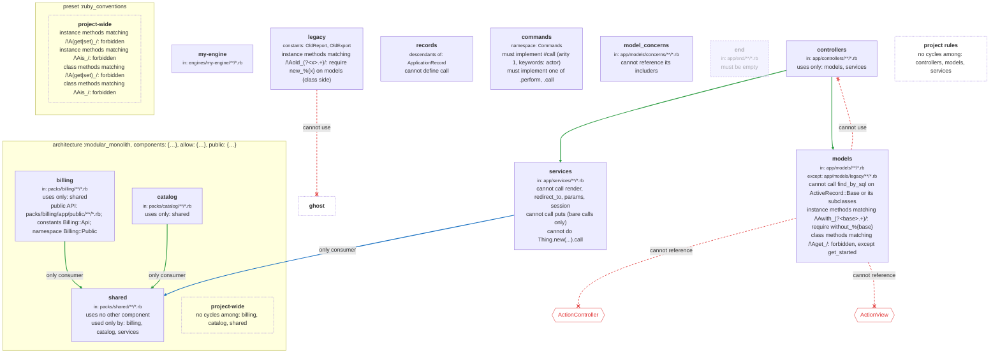

# archspec_diagram

Draw an [Archspec](https://archspecrb.dev) `Archspec.rb` as a Mermaid flowchart: components as boxes, allowed and forbidden dependencies as arrows, the other rules as text inside the boxes. It reads the config the way `archspec check` does but never analyzes your code, so it is fast and needs no Rails boot.

```sh
gem install archspec_diagram
```

Requires Ruby 3.2 or later and archspec 1.1.x.

## Usage

```sh
archspec_diagram                          # ./Archspec.rb -> Mermaid on stdout
archspec_diagram path/to/app              # a directory works; uses its Archspec.rb
archspec_diagram -f markdown -o ARCHITECTURE.md
archspec_diagram -f html -o arch.html && open arch.html
archspec_diagram --focus billing -d LR    # one component and its neighbours
archspec_diagram --detail reasons         # names | rules (default) | reasons
```

Errors are one line on stderr, never a backtrace. Exit status is 0 on success, 1 for a config or I/O problem (`archspec_diagram: could not load Archspec.rb: undefined local variable or method 'modles'`), and 2 for a usage error (`archspec_diagram: unknown format: svg (expected mermaid, markdown or html)`).

### Options

| Option | Values | Default | Effect |
| --- | --- | --- | --- |
| `-f`, `--format` | `mermaid`, `markdown`, `html` | `mermaid` | `mermaid` is the bare diagram for pasting into GitHub, Notion or `mmdc`. `markdown` is a heading, a fenced block and a legend table. `html` is a standalone page that loads Mermaid 11.4.1 from jsdelivr. |
| `-d`, `--direction` | `TB`, `BT`, `LR`, `RL` | `TB` | Layout direction. |
| `--detail` | `names`, `rules`, `reasons` | `rules` | `names`: components and arrows. `rules`: plus selectors and rule lines. `reasons`: plus every `because:` text. |
| `--focus` | a component name | none | Keep one component, every component it links to or from, and the project-wide rules. |
| `-o`, `--output` | a file | stdout | Written to a temporary file and renamed, so a failed run leaves the previous diagram in place. |
| `-v`, `--version`, `-h`, `--help` | | | |

### From Ruby

```ruby
ArchspecDiagram.render("Archspec.rb", format: :markdown, direction: :LR, detail: :rules, focus: :billing)
```

`render` returns a String and raises `ArchspecDiagram::Error` (a subclass of `ArchSpec::Error`) with a one-line message for every user-caused failure: bad options, a missing, unreadable, broken or empty config, an unknown `focus`. A test that fails when a committed diagram is stale:

```ruby
assert_equal File.read("docs/architecture.mmd"), ArchspecDiagram.render("Archspec.rb")
```

Rendering is deterministic and follows declaration order, so an unchanged config produces an unchanged diagram.

## What is drawn

| In Archspec.rb | In the diagram |
| --- | --- |
| `component :x, in:, except:, namespace:, constants:, descendants_of:` | A box named `x` with its selectors as small text. Flat, never nested, because selectors overlap. |
| `architecture :name` / `preset :name` | A labelled group around the components the call declared, plus a "project-wide" note for its project-wide rules. Two identical calls stay two groups. |
| `can_only_use` | Green arrows to each allowed component and a "uses only: ..." line (or "uses no other component"). |
| `cannot_use` | Red dashed arrows ending in a cross, labelled "cannot use". |
| `can_only_be_used_by` | Thick blue arrows from each consumer, labelled "only consumer", and a "used only by: ..." line. When the same pair also has a `can_only_use` arrow, the two merge into one green arrow labelled "only consumer". |
| `cannot_reference_constants` | A red hexagon per constant and a dashed red arrow to it, labelled "cannot reference". |
| `must_be_empty` | A dashed, faded box with "must be empty". |
| `no_cycles`, `method_names.matching(...)` without a component | A dashed "project rules" note (top level) or "project-wide" note (inside a preset group). |
| `cannot_call`, `cannot_define`, `cannot_instantiate_and_invoke`, `cannot_reference_includers`, `must_implement`, `must_implement_one_of`, `public_api`, `method_names.matching(...)` on a component | One line of text in the component's box. |
| `because:` | At `--detail reasons`, an italic line under the rule's text, or on the arrow for rules that only draw arrows. |
| A component a rule names but nothing declares | A dashed box. |
| Any rule object archspec_diagram does not know (`rule obj`) | A generic "rule <id>" line. |
| `root`, `source`, `ignore`, `todo` | Not drawn. |

The text of each rule lives in `lib/archspec_diagram/clauses.rb`, one decoder per archspec rule class; `test/rule_coverage_test.rb` fails when archspec ships a rule class without one. All Mermaid syntax (ids, escaping, arrows, styles) lives in `flowchart.rb`.

## Example

Rendered from `test/fixtures/kitchen_sink/Archspec.rb`, which uses every verb (`archspec_diagram test/fixtures/kitchen_sink`):



## Development

```sh
ruby -Itest -e 'Dir["test/*_test.rb"].each { load _1 }'
MMDC=path/to/mmdc ruby -Itest test/render_test.rb   # also checks the golden diagrams parse
UPDATE_GOLDEN=1 ruby -Itest test/render_test.rb     # rewrite test/golden after an intended change
```

`test/property_test.rb` states two properties with [hegeltest](https://github.com/meganemura/hegel-ruby): label text carries no Mermaid syntax and unescapes to its input, and every component is one node and every edge joins two nodes. hegeltest needs Ruby 3.4 or later, so these tests skip on an older Ruby. On Ruby 4.0 the suite also loads [bulldogger](https://github.com/meganemura/bulldogger), which writes each failure with its frame values to `tmp/bulldogger/` and prints the evidence path and a rerun command.

The golden diagrams in `test/golden` come from the Archspec.rb files of archspec itself, fizzy, mastodon, discourse and the rails_app fixture (vendored under `test/fixtures/upstream`), plus the kitchen sink.

## License

MIT.
